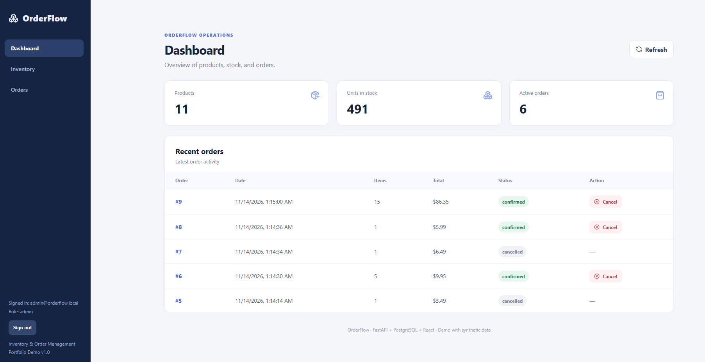
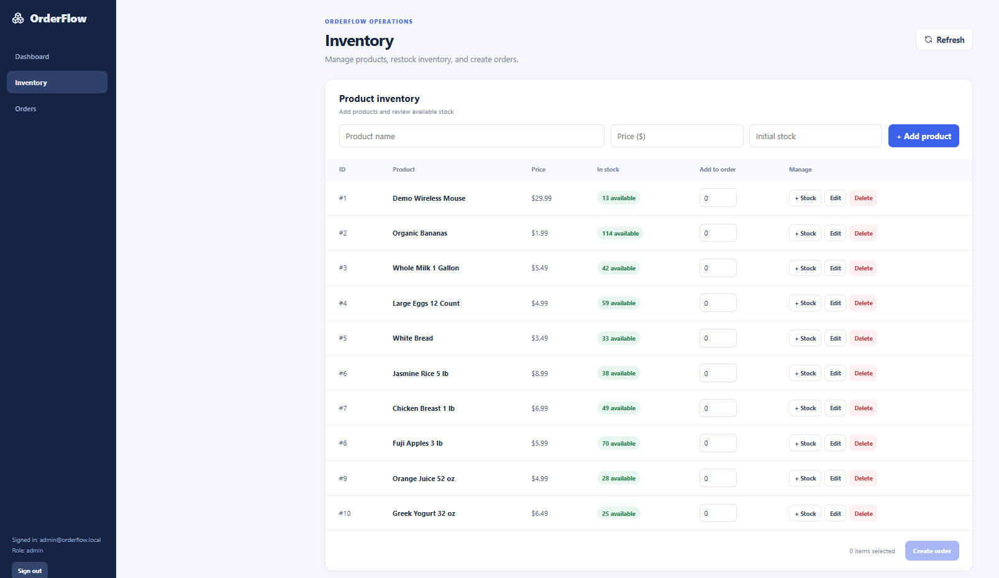
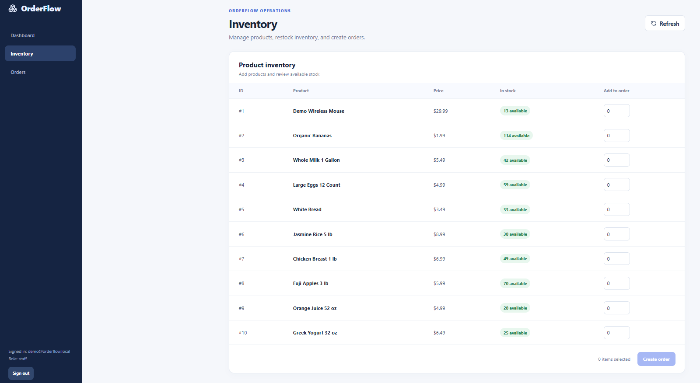
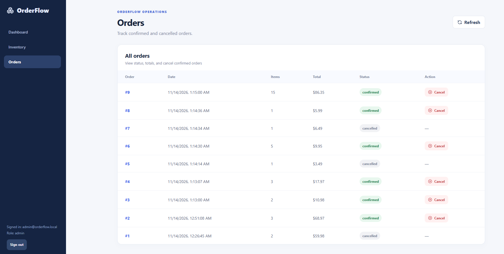
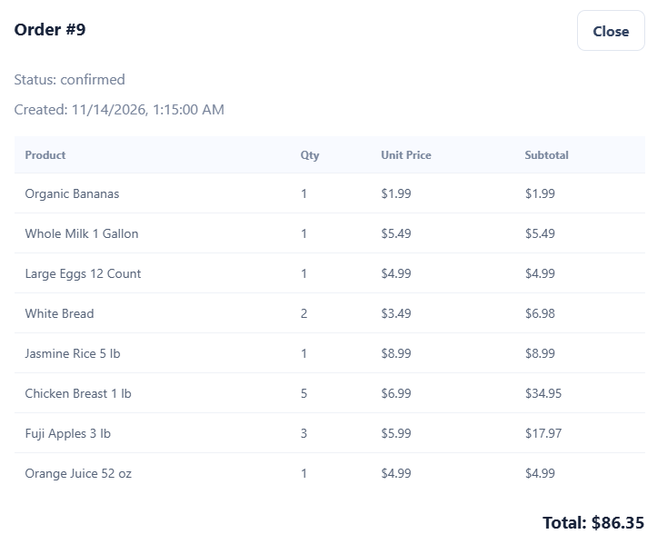

# OrderFlow

OrderFlow is a small inventory and order management app I built to get more hands on experience with backend development. It lets users manage products, track stock, place orders, and cancel orders without losing track of inventory.

The main challenge I wanted to work through was keeping stock counts accurate when multiple requests happen at the same time. I also wanted to take a project beyond local development, so OrderFlow includes authentication, automated tests, and a live deployment.

**[Live app](https://orderflow-platform-beryl.vercel.app/)** · **[API docs](https://orderflow-api-3dz8.onrender.com/docs)**

The app requires an account to sign in. Public demo credentials are not available yet. Since the API runs on Render's free tier, the first request after a period of inactivity may take a little longer.

## What it does

- **Products and inventory:** Admins can add products, update details, adjust stock, and delete products that are not referenced by orders.
- **Orders:** Users can create orders with multiple items. The app checks stock, deducts the quantities, and saves the price of each item at the time of purchase.
- **Cancellations:** Admins can cancel orders, and the app returns the reserved quantities to inventory.
- **Accounts and permissions:** Users sign in with JWT-based authentication. Admins manage inventory and cancellations; staff can view products and create orders.
- **Stock protection:** The API rejects orders when there is not enough stock, including when requests arrive concurrently.

## Screenshots

## Screenshots

### Dashboard
Overview of products, inventory, and orders.



### Inventory Management — Admin
Admins can manage products and update inventory.



### Inventory — Staff
Staff can view inventory without access to admin-only controls.



### Orders
View and manage customer orders.



### Order Details
View ordered products, quantities, unit prices, and totals.



## Tech stack

- **Backend:** Python, FastAPI, SQLAlchemy, Alembic, Psycopg 3
- **Database:** PostgreSQL
- **Frontend:** React, TypeScript, Vite
- **Authentication:** JWT and role-based access control
- **Development and testing:** Docker Compose, pytest, GitHub Actions
- **Hosting:** Vercel (frontend), Render (API), Neon (PostgreSQL)

## A few implementation details

### Preventing overselling

Consider two orders arriving at nearly the same time, both trying to buy the last item in stock. Reading the quantity first and updating it later is not enough: both requests could see the same available stock.

OrderFlow uses a conditional PostgreSQL `UPDATE` inside a transaction. Stock is deducted only if enough inventory is still available when the update runs. If not, the API returns a conflict instead of allowing the quantity to go negative.

### Making cancellations safe

Canceling an order needs to restore its stock, but doing that twice would inflate inventory. The cancellation flow locks the order row so concurrent cancellation requests cannot both restore the same items.

### Keeping the database schema and tests in sync

I use Alembic for schema changes and a separate PostgreSQL test database for integration tests. The backend currently has **11 passing tests**, covering product operations, order creation and cancellation, concurrent requests, and authentication/permissions. GitHub Actions runs checks on pushes and pull requests.

## Running locally

You will need Docker Desktop and Docker Compose.

1. Clone the repository and open a terminal in its root directory.
2. Set up the local environment files. The root `.env` needs a `JWT_SECRET_KEY`; use `backend/.env.example` as a reference for backend settings. Keep real secrets out of Git.
3. Start the services:

   ```powershell
   docker compose up -d --build
   ```

4. Apply database migrations:

   ```powershell
   docker compose run --rm -e PYTHONPATH=/code backend alembic upgrade head
   ```

5. Create an admin account (you'll be prompted for a password):

   ```powershell
   docker compose run --rm -e PYTHONPATH=/code backend python create_user.py --email admin@orderflow.local --role admin
   ```

Once the services are running:

- App: http://localhost:5173
- API documentation: http://localhost:8000/docs
- Health check: http://localhost:8000/health

Stop the services with `docker compose down`. Avoid `docker compose down -v` unless you intend to remove the local database volume.

## Running tests

Tests use a separate database named `orderflow_test`. Create it and apply the latest Alembic migrations before running the suite. Do not run the tests against your development or cloud database.

```powershell
docker compose run --rm -e PYTHONPATH=/code -e DATABASE_URL=postgresql+psycopg://orderflow:orderflow_dev@db:5432/orderflow_test backend pytest -q
```

## How it's deployed

The React app is hosted on Vercel. Requests to `/api` are forwarded to the FastAPI service on Render, which connects to PostgreSQL on Neon. The same project also runs locally with Docker Compose.

The deployed app has been tested with the full order flow: sign in, add a product, adjust stock, create an order, and cancel it to restore inventory.

## Current limitations

This is a portfolio project using synthetic data, not a commercial order processing system. It does not handle payments, shipping, or customer accounts. I would also add monitoring, stronger operational safeguards, and more deployment automation before using it for real business data.
