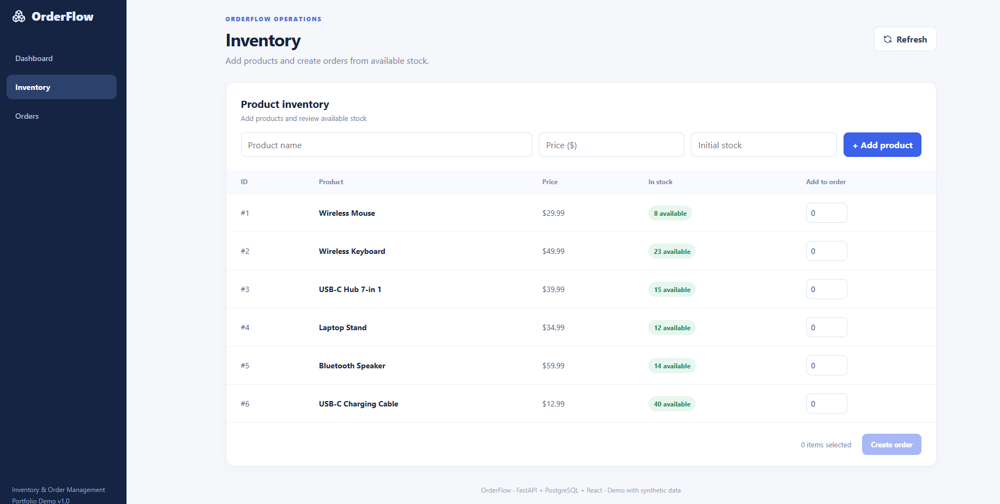

# OrderFlow — Inventory & Order Management Platform

A backend-focused full-stack portfolio application using **FastAPI, PostgreSQL, SQLAlchemy, Alembic, React, TypeScript, Docker, and GitHub Actions**. Uses synthetic demo data.

## Application Screenshots

### Dashboard
Overview of products, available inventory, and recent orders.


### Inventory Management
Manage products, monitor stock levels, and create orders.



### Order Management
Track order status, review totals, and cancel orders.


## Features
- Product create/list/detail/update/delete (products referenced by orders cannot be deleted)
- Atomic inventory adjustments with insufficient-stock conflict handling
- Multi-item order creation with transactional stock deduction and price snapshots
- Duplicate product lines consolidated within each order
- Concurrent stock updates guarded by PostgreSQL conditional UPDATE
- Order cancellation restores inventory once, using a locked order row
- Responsive React dashboard for product creation, cart-like ordering, and cancellation
- OpenAPI documentation, Alembic database migrations, and 10 automated tests integrated with GitHub Actions CI

## Quick start (Windows 11 + Docker Desktop)

Open PowerShell in the `orderflow-platform` folder:

```powershell
docker compose up --build -d
docker compose exec backend alembic upgrade head
```

Open:
- Frontend: http://localhost:5173
- API docs: http://localhost:8000/docs
- Health: http://localhost:8000/health

Create a product in the dashboard, enter a quantity in **Add to order**, and select **Create order**. Orders are confirmed immediately for this demo; no payment provider is integrated.

Stop containers: `docker compose down`. Keep data: do not use `-v` unless you intentionally want to delete this project's Docker database volume.

**Port conflicts:** PostgreSQL host port is `5433`, leaving an existing PostgreSQL installation on `5432` untouched. If port `8000` or `5173` is occupied, adjust the host side of the port mapping in `compose.yaml`.

## API routes
| Method | Path | Purpose |
|---|---|---|
| GET | `/health` | Health check |
| GET/POST | `/products` | List/create products |
| GET/PATCH/DELETE | `/products/{id}` | Read/update/delete product |
| PATCH | `/products/{id}/inventory` | Atomic stock change |
| GET/POST | `/orders` | List/create orders |
| GET | `/orders/{id}` | Read order |
| POST | `/orders/{id}/cancel` | Cancel and restock |

Example order request:
```json
{"items":[{"product_id":1,"quantity":2},{"product_id":2,"quantity":1}]}
```

## Testing

OrderFlow includes 10 automated tests covering:

- API health and request validation
- Product creation, retrieval, updates, and deletion
- Inventory updates and insufficient-stock protection
- Order creation, retrieval, and cancellation
- Inventory restoration after cancellation
- Concurrent order placement to prevent overselling
- Concurrent cancellation to prevent duplicate restocking

### Run Tests Locally

Create and migrate the test database before the first run.

Run the complete test suite:

```powershell
docker compose exec -e PYTHONPATH=/code -e DATABASE_URL=postgresql+psycopg://orderflow:orderflow_dev@db:5432/orderflow_test backend pytest -v
```

Expected result: 10 tests passed.

### Continuous Integration

GitHub Actions automatically runs on pushes and pull requests.

The CI pipeline:

1. Starts PostgreSQL 17.
2. Installs Python dependencies.
3. Applies Alembic database migrations.
4. Runs all backend tests.
5. Installs frontend dependencies.
6. Builds the React/TypeScript frontend.

### Concurrency Safety

OrderFlow uses PostgreSQL transactions and atomic inventory updates to prevent overselling.

Order cancellation uses row-level locking to prevent concurrent cancellation requests from restoring inventory more than once.

These behaviors are verified by dedicated concurrency integration tests.

**Note:** OrderFlow is a portfolio MVP, not a production-ready payment or fulfillment system.


## Architecture
- `backend/app/main.py` HTTP endpoints and transactional operations
- `backend/app/models.py` relational schema
- `backend/app/schemas.py` request and response validation
- `backend/migrations/` versioned PostgreSQL schema
- `frontend/src/` React dashboard
- `.github/workflows/ci.yml` Python and TypeScript checks

## Security & limitations
- **Demo only:** no authentication, authorization, payment processing, or production secrets management.
- Do not expose the API or database publicly without adding authentication, network restrictions, and production configuration.
- The development PostgreSQL password is intentionally sample-only. Replace it before deployment.
- Data persists in a dedicated Docker volume; the previous learning OMS project is not modified.
